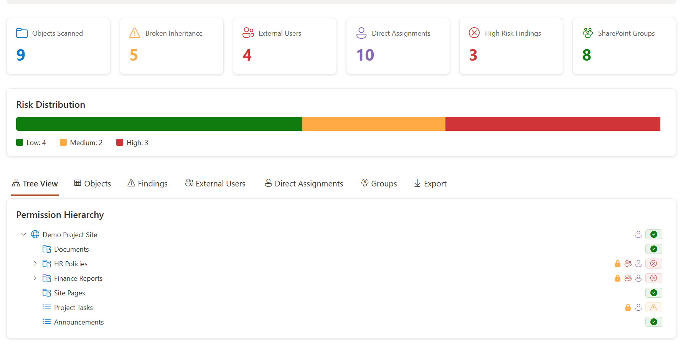

# SPFx Permission Visualizer



**SPFx Permission Visualizer** is an open-source SharePoint Framework solution that helps SharePoint admins visualize SharePoint Online permissions, broken inheritance, external users, direct assignments, SharePoint groups, and access risk from a modern dashboard.

This project is designed for real SharePoint administration scenarios where permission structures become difficult to understand over time due to unique permissions, direct user access, external sharing, and unclear group ownership.

---

## Why This Project Exists

SharePoint permission issues rarely happen all at once.

They usually build up slowly through:

- Broken permission inheritance
- Direct user assignments
- External users added over time
- SharePoint groups that no one reviews
- Sensitive libraries with unique permissions
- Migration projects where access cleanup is discovered too late

This web part gives SharePoint admins a visual way to understand permission risk faster.

Instead of manually opening each list, library, folder, or group, the dashboard highlights the areas that need attention.

---

## Features

### Permission Dashboard

The dashboard provides a quick summary of permission health across the current SharePoint site.

It includes:

- Objects scanned
- Broken inheritance count
- External users count
- Direct assignments count
- High-risk findings
- SharePoint groups count

---

### Risk Distribution

The solution includes a simple risk distribution view that separates scanned objects into:

- Low risk
- Medium risk
- High risk

This helps admins quickly understand whether the site is mostly healthy or requires deeper review.

---

### Permission Hierarchy Tree View

The tree view provides a visual permission hierarchy for the current SharePoint site.

It can display:

- Site
- Lists
- Libraries
- Folders
- Permission indicators
- Risk indicators
- Broken inheritance status
- External user indicators
- Direct assignment indicators

This makes it easier to identify where permission complexity exists.

---

### Permission Objects View

The objects view helps admins review scanned SharePoint objects and understand:

- Object name
- Object type
- Permission inheritance status
- Risk level
- Related findings
- External access indicators
- Direct assignment indicators

---

### Findings View

The findings view highlights permission-related issues such as:

- Broken inheritance
- External users
- Direct user assignments
- High-risk permission patterns
- SharePoint groups that may need review

Each finding is intended to help admins understand what should be reviewed next.

---

### External Users View

The external users view helps identify guest or external access across the scanned site.

This is useful for:

- Security reviews
- Compliance checks
- Migration readiness
- External sharing cleanup
- Governance reporting

---

### Direct Assignments View

Direct user permissions can become difficult to manage because access is assigned to individual users instead of groups.

This view helps identify cases where users may have been granted access directly.

Recommended best practice is usually to manage access through SharePoint groups, Microsoft 365 groups, or security groups where possible.

---

### SharePoint Groups View

The groups view helps admins review SharePoint groups and group membership.

This is useful for understanding:

- Owners
- Members
- Visitors
- Custom SharePoint groups
- Group membership patterns
- Potential governance issues

---

### Export

The solution includes export functionality so admins can use the data outside the web part for review, reporting, or cleanup planning.

Possible export use cases:

- Governance review
- Permission cleanup planning
- Migration assessment
- Security review
- Documentation
- Stakeholder reporting

---

## Tech Stack

This project uses:

- SharePoint Framework
- React
- TypeScript
- Fluent UI
- PnPjs
- SharePoint REST API
- Modern SharePoint Online

---

## Project Goals

The goal of this project is to provide a read-only permission visibility tool for SharePoint admins.

Version 1 focuses on visibility and reporting, not automatic cleanup.

The web part should help answer questions like:

- Which objects have broken inheritance?
- Where are external users present?
- Which users have direct permissions?
- Which SharePoint groups exist?
- Which areas are high risk?
- What should be reviewed before a migration or governance cleanup?

---

## Important Safety Note

This solution is intended to be **read-only**.

It does not automatically:

- Remove users
- Change permissions
- Break inheritance
- Restore inheritance
- Delete groups
- Modify group membership
- Grant access
- Revoke access

The goal is to help admins review and understand permission structure before making changes.

---

## Requirements

Recommended environment:

- SharePoint Online
- SharePoint Framework supported Node.js version
- Site Owner permission or higher for best results
- Tenant App Catalog for deployment

Recommended user permission:

```text
Site Owner or SharePoint Administrator
```

Users with lower permissions may see partial results depending on what they are allowed to access.

---

## Getting Started

Clone the repository:

```bash
git clone https://github.com/BillySharePoint/spfx-permission-visualizer.git
cd spfx-permission-visualizer
```

Install dependencies:

```bash
npm install
```

Run the local SPFx workbench:

```bash
gulp serve
```

For SharePoint Online testing, use the hosted workbench from your tenant:

```text
https://yourtenant.sharepoint.com/sites/yoursite/_layouts/15/workbench.aspx
```

---

## Build

Run a local build:

```bash
gulp build
```

Bundle for production:

```bash
gulp bundle --ship
```

Package the solution:

```bash
gulp package-solution --ship
```

The generated `.sppkg` file will be available in:

```text
sharepoint/solution/
```

Upload the package to your SharePoint tenant app catalog.

---

## Deployment

1. Build and package the solution.
2. Upload the `.sppkg` file to the SharePoint App Catalog.
3. Approve the deployment.
4. Add the app to a SharePoint site.
5. Add the web part to a modern SharePoint page.
6. Run the permission scan.

---

## Configuration

Depending on implementation, the web part may include configuration options such as:

- Web part title
- Include folders
- Include list items
- Include hidden lists
- Maximum items per list
- Enable demo/mock mode

Item-level permission scanning can be expensive on large libraries, so it should be used carefully.

---

## Recommended Scan Approach

For best performance, start with:

- Site-level permissions
- Lists and libraries
- SharePoint groups
- External user detection
- Direct assignment detection

Then enable deeper scanning only when needed:

- Folder-level scanning
- Item-level scanning

Large libraries may take longer to scan.

---

## Risk Indicators

The project uses visual indicators to help admins quickly understand permission status.

Example indicators:

- Green: low risk or healthy state
- Orange: review recommended
- Red: high risk or important finding
- Lock icon: unique permissions or restricted access
- User icon: direct assignment
- Group icon: SharePoint group or external access indicator

---

## Suggested Risk Logic

The risk scoring model can include checks such as:

| Condition | Risk Impact |
|---|---|
| Object has unique permissions | Medium |
| External users detected | Medium/High |
| Direct user assignments detected | Medium |
| Folder or item has broken inheritance | Medium/High |
| Too many owners | Medium |
| Sensitive library has unique permissions | High |
| Broad access with edit/full control | High |

Risk levels can be grouped as:

```text
Low
Medium
High
```

---

## Use Cases

This project can help with:

- SharePoint permission reviews
- Microsoft 365 governance
- External sharing audits
- Migration readiness assessments
- Site owner reviews
- Security cleanup planning
- Intranet governance
- Compliance documentation
- Admin troubleshooting

---

## Portfolio Value

This project demonstrates practical Microsoft 365 and SharePoint skills, including:

- SPFx development
- React and TypeScript
- SharePoint permission concepts
- PnPjs usage
- Admin-focused UX
- Governance thinking
- Risk-based reporting
- Real-world SharePoint troubleshooting

It is designed to show that SharePoint development is not only about building web parts, but also about solving real business and administration problems.

---

## Roadmap

Planned or possible future enhancements:

- Tenant-wide permission scanning
- Microsoft Graph enrichment
- Sharing link detection
- Anonymous link detection
- Sensitivity label awareness
- Export to Excel
- PDF report generation
- Permission history comparison
- Scheduled scan snapshots
- Microsoft Lists integration for review tracking
- Viva Connections Adaptive Card Extension
- Teams tab version
- Power Automate approval workflow for permission review

---

## Known Limitations

- The solution depends on the current user's SharePoint permissions.
- Users without permission to view role assignments may see incomplete results.
- Large list or item-level scanning may take longer.
- Some permission data may require elevated access.
- Version 1 is focused on the current site, not tenant-wide scanning.

---

## Contributing

Contributions are welcome.

Good contribution areas include:

- Performance improvements
- Additional permission findings
- Better export formats
- UI improvements
- Accessibility improvements
- Documentation updates
- Support for more permission scenarios

---

## License

MIT. See [LICENSE](./LICENSE).

---

## Related

- Article: [Building a SharePoint Permission Visualizer with SPFx](https://www.billyperalta.com/blog/building-sharepoint-permission-visualizer-spfx/?utm_source=github&utm_medium=referral&utm_campaign=spfx_permission_visualizer&utm_content=readme_article)
- Need this across a whole tenant? See the [SharePoint permissions and oversharing assessment](https://www.billyperalta.com/services/sharepoint-permissions-cleanup-consultant/?utm_source=github&utm_medium=referral&utm_campaign=spfx_permission_visualizer&utm_content=readme_service_cta).
- Author: [Billy Peralta](https://www.billyperalta.com/?utm_source=github&utm_medium=referral&utm_campaign=spfx_permission_visualizer), SharePoint and Microsoft 365 consultant, Vancouver, BC
